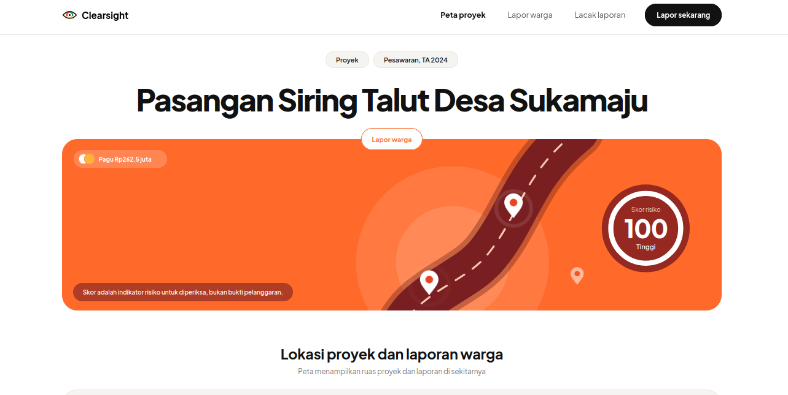
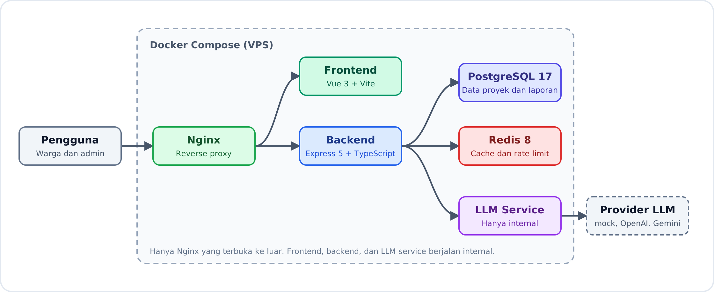

<div align="center">

# Clearsight

**Platform pemantauan proyek publik yang membuka data proyek pemerintah daerah untuk warga.**
Lihat progres di peta, telusuri profil dan skor risiko proyek, kirim laporan warga, dan baca penjelasan risiko dalam bahasa awam.

[](https://bordrex.my.id/)


</div>



> Aplikasi ini berjalan dalam **mode simulasi**. Lihat [Catatan Data dan Batasan](#catatan-data-dan-batasan).

## Coba Langsung

- **Aplikasi:** https://bordex.my.id
- **Form lapor warga:** https://bordex.my.id/lacak-laporan
- **Panel admin:** tidak dibuka untuk umum karena menyangkut data laporan warga. Tampilannya ada di bagian [Tampilan Aplikasi](#tampilan-aplikasi).

## Latar Belakang

Data pengadaan dan anggaran daerah sebenarnya terbuka, tetapi tersebar di banyak portal (SiRUP, LPSE/SPSE, data APBD) dan sulit dibaca warga awam. Clearsight menyatukan data tersebut, menghitung indikator risiko tiap proyek dengan aturan yang transparan, lalu menyajikannya di peta dan halaman profil proyek. Warga juga bisa mengirim laporan lapangan lengkap dengan bukti foto atau video.

## Fitur Utama

- **Peta proyek** (Leaflet) dengan filter wilayah dan kategori serta ringkasan KPI.
- **Profil proyek** berisi skor dan kategori risiko, radar enam dimensi, daftar indikator beserta sumber datanya, pembayaran termin dibanding progres fisik, linimasa, rincian RAB vs harga acuan, dan dokumen publik.
- **Penjelasan risiko berbahasa awam** dari layanan LLM, dimuat non-blocking agar halaman tetap cepat.
- **Laporan warga**: form dengan ukuran lapangan dan unggah foto/video, serta halaman pelacakan laporan per tiket.
- **Panel admin** dengan peran `admin`, `verifikator`, dan `peninjau`: verifikasi laporan, CRUD proyek/tender/RAB/pembayaran/progres fisik, log audit, pemantauan AI, dan log notifikasi surel.
- **Pipa ETL**: impor CSV/JSON untuk paket pengadaan, anggaran dinas, dan peserta tender, dengan pencocokan paket antarsumber dan rekalkulasi skor otomatis.
- **Notifikasi surel HTML** responsif untuk pelapor.

## Tampilan Aplikasi

| Detail Proyek | Form Lapor Warga |
| :---: | :---: |
|  |  |

| Panel Admin | Manajemen Data & ETL |
| :---: | :---: |
|  |  |

## Keputusan Teknis yang Menonjol

- **Skor risiko deterministik dan bisa diaudit.** Skor dihitung mesin aturan dari `backend/config/scoring.json` (12 indikator, `D1-01` sampai `D6-02`). LLM hanya menjelaskan skor yang sudah final dan tidak pernah menghitung atau mengubahnya. Bobot dan ambang hanya bisa diubah lewat berkas yang terlacak git, bukan lewat API.
- **Perlindungan data pelapor.** Kontak pelapor dienkripsi AES-256-GCM, metadata EXIF/GPS pada foto dibersihkan, dan retensi kontak diatur.
- **Jejak yang tidak bisa diubah.** Log audit dan `riwayat_nilai` bersifat append-only, dengan pengaman anti-manipulasi skor pada API admin.
- **ETL yang aman.** Eksekusi memakai advisory lock PostgreSQL agar tidak berjalan ganda, NPWP otomatis di-hash SHA-256, dan data pribadi disaring sebelum masuk log kesalahan.
- **Guardrail LLM.** Payload divalidasi Zod, ada filter frasa terlarang, dan provider bisa diganti (`mock`, `openai`, `gemini`) lewat konfigurasi.
- **Performa dan proteksi.** Cache Redis untuk respons GET dan hasil LLM (dengan invalidasi saat data berubah), serta rate limit pada API dan LLM.
- **Kualitas rekayasa.** Validasi input dengan Zod, migrasi skema dengan `node-pg-migrate`, dokumentasi Swagger OpenAPI (45 operasi pada 40 path), dan unit test untuk backend dan LLM service.

## Arsitektur



Seluruh trafik HTTP masuk lewat Nginx. Frontend, backend, dan LLM service tidak di-expose langsung ke host, dan LLM service hanya bisa diakses internal oleh backend.

## Tech Stack

| Lapisan | Teknologi |
| --- | --- |
| Frontend | Vue 3, Vite, Vue Router, Pinia, Bootstrap 5, Leaflet (`@vue-leaflet/vue-leaflet`), Axios |
| Backend | Node.js 20, TypeScript, Express 5, PostgreSQL 17 (`pg`, `node-pg-migrate`), Redis 8, Zod, `bcrypt`, `jsonwebtoken`, `multer`, `nodemailer`, `express-rate-limit`, Swagger UI Express |
| LLM Service | Node.js 20, TypeScript, Express 5, Zod; provider `mock`, `openai`, atau `gemini` |
| Infrastruktur | Docker + Docker Compose (`nginx`, `frontend`, `backend`, `backend-init`, `llm`, `db`, `redis`), Nginx 1.27-alpine, Certbot untuk HTTPS |

## Catatan Data dan Batasan

Aplikasi ini **masih berjalan dalam mode simulasi**. Data proyek berasal dari pemberitaan publik, sedangkan data pelengkap yang tidak terbuka untuk publik (pembayaran per termin, progres fisik lapangan, RAB rinci) dibuat tim dan ditandai permanen `is_dummy = true`. Label itu dipertahankan apa adanya sampai tersedia akses data resmi.

Seluruh angka yang ditampilkan adalah **indikator risiko untuk diperiksa, bukan bukti pelanggaran.**

## Deployment

Demo berjalan di VPS dengan Docker Compose dalam mode produksi:

- Nginx sebagai reverse proxy dengan HTTPS dari Certbot
- Redis dengan `--requirepass` dan kredensial Postgres dari `.env.production`
- Migrasi dan seed otomatis lewat service `backend-init`
- Swagger hanya aktif pada mode development

Langkah singkat untuk produksi:

1. Salin `.env.production.example` menjadi `.env.production`, isi kata sandi Postgres/Redis dan URL domain, lalu lengkapi `JWT_SECRET`, `ENCRYPTION_KEY`, dan `SMTP_*` di `backend/.env`.
2. Pada `compose.yml`, aktifkan baris dan blok bertanda `# PROD` serta komentari baris bertanda `# DEV`. Sesuaikan domain dan jalur sertifikat di `nginx/nginx.conf`.
3. Jalankan:
   ```sh
   docker compose --env-file .env.production up -d --build
   ```

## Menjalankan Secara Lokal

Prasyarat: Git, Docker, dan Docker Compose.

```sh
# 1. Clone
git clone <url-repo>
cd <nama-folder>

# 2. Siapkan environment
cp backend/.env.example backend/.env
cp llm-service/.env.example llm-service/.env
# sesuaikan bila perlu (ADMIN_EMAIL, ADMIN_PASSWORD, SMTP_*, AI_PROVIDER)

# 3. Jalankan seluruh stack
docker compose up -d --build

# 4. Buat akun admin (setelah ADMIN_EMAIL, ADMIN_PASSWORD, ADMIN_NAMA diisi di backend/.env)
docker compose exec backend npm run seed:admin
```

Migrasi database dan seed data awal berjalan otomatis lewat service `backend-init` sebelum `backend` sehat. Akun admin dibuat dari variabel lingkungan, bukan kredensial yang ditulis di kode.

| Layanan | URL |
| --- | --- |
| Aplikasi | http://localhost |
| Panel admin | http://localhost/admin/login |
| Backend API | http://localhost/api (mis. `/api/ping`) |
| Swagger (dev) | http://localhost/docs (spec: http://localhost/docs.json) |
| Postgres | `localhost:5433` |
| Redis | `localhost:6379` |

`compose.yml` secara default dikonfigurasi untuk **mode development** (`NODE_ENV=development`, Nginx memakai `nginx/dev.conf`, CORS terbuka untuk `http://localhost` dan `http://localhost:5173`). Baris produksi tersedia sebagai komentar bertanda `# PROD`, jangan dipakai di lokal.

## Pengujian

```sh
# Backend
cd backend && npm test && npm run build

# LLM Service
cd llm-service && npm test && npm run build

# Frontend
cd frontend && npm run lint && npm run build
```

## Dokumentasi Lanjutan

- [Panduan Impor Data ETL (CSV & JSON)](ETL.md): format berkas, aturan validasi, dan contoh untuk paket pengadaan, anggaran dinas, serta peserta tender.
- Swagger/OpenAPI tersedia di `/docs` pada mode development.

## Status dan Roadmap

**Sudah selesai**
- Dashboard peta, halaman detail proyek, form dan pelacakan laporan warga, serta panel admin
- API publik dan admin lengkap, mesin skor 12 indikator, ETL dengan pencocokan paket
- Layanan LLM untuk penjelasan risiko (`LLM-T1`) dan draf tindak lanjut (`LLM-T2`)
- Autentikasi JWT dengan otorisasi peran, log audit, cache Redis, rate limit, notifikasi surel
- Unit test untuk backend dan LLM service

**Rencana**
- [ ] Penyambungan ke API data pemerintah secara live di luar mode simulasi (menunggu verifikasi ToS tiap portal sumber)
- [ ] Umpan balik otomatis ke pelapor (`LLM-T3`)
- [ ] Form impor/input untuk data standar harga acuan, dokumen publik, checklist prosedur, dan koordinat peta

## Kontribusi

Seluruh bagian proyek ini saya kerjakan sendiri, mulai dari perancangan hingga deployment:

- **Frontend:** dashboard peta, halaman detail proyek, form dan pelacakan laporan warga, serta panel admin (Vue 3)
- **Backend:** API publik dan admin, mesin skor risiko, autentikasi dan otorisasi peran, enkripsi data pelapor, notifikasi surel (Express 5, PostgreSQL, Redis)
- **LLM Service:** integrasi provider, validasi payload, dan guardrail
- **ETL:** impor CSV/JSON, pencocokan paket antarsumber, dan rekalkulasi skor
- **Infrastruktur:** Docker Compose, Nginx, HTTPS Certbot, dan deployment di VPS
- **Pengujian dan dokumentasi:** unit test, Swagger/OpenAPI, dan README ini

## Lisensi

Dirilis di bawah [MIT License](LICENSE). Copyright (c) 2026 Akbar Vabiansyah, Ferdi Kurniawan, M Rizky Arya Seto.