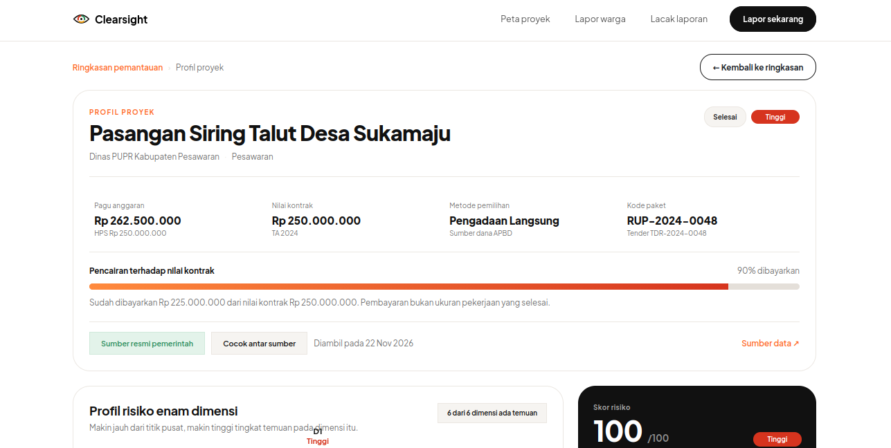
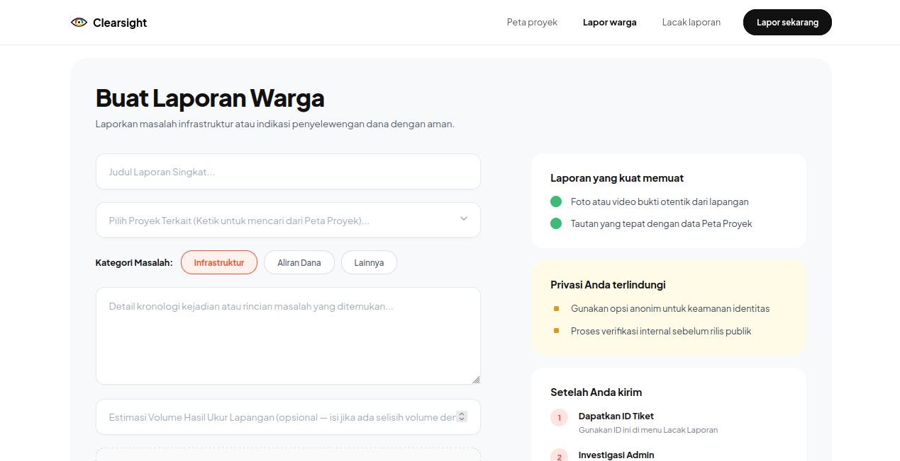
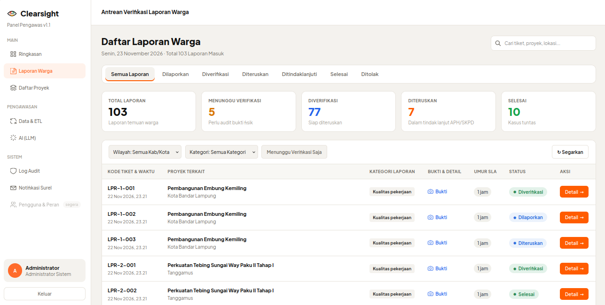
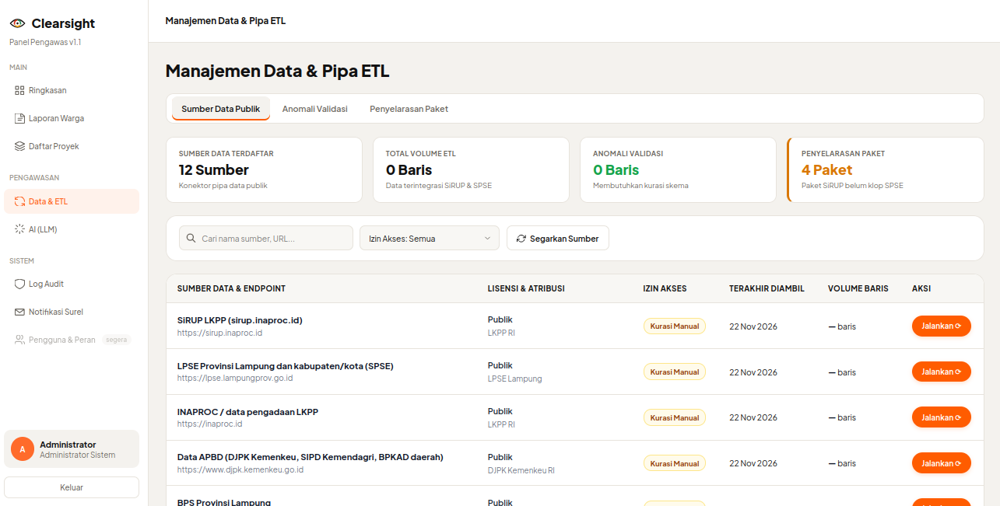

<div align="center">

# Clearsight

**Public project monitoring platform unlocking local government procurement data for citizens.**
Explore project progress on the map, inspect risk profiles and scores, submit citizen reports, and read layman-friendly risk explanations.

[](https://bordrex.my.id/)


</div>


> This application runs in **simulation mode**. See [Data Notes and Limitations](#data-notes-and-limitations).

## Try It Live

- **Web Application:** https://bordex.my.id
- **Citizen Report Form:** https://bordex.my.id/lacak-laporan
- **Admin Panel:** Not publicly accessible due to citizen report privacy considerations. Previews are available in the [Application Preview](#application-preview) section.

## Background

Public procurement and local government budget data are theoretically open, yet scattered across disparate portals (SiRUP, LPSE/SPSE, regional budget APBD portals) and difficult for the general public to decipher. Clearsight consolidates this data, evaluates risk indicators for each project using transparent rules, and visualizes them on interactive maps and project profile pages. Citizens can also submit on-site reports complete with photo or video evidence.

## Key Features

- **Interactive Project Map** (Leaflet) with regional and sector category filters, as well as high-level KPI summaries.
- **Detailed Project Profile** featuring risk score and category, 6-dimension radar chart, indicator breakdown with data sources, milestone payments vs. physical progress curve, project timeline, itemized Bill of Quantities (BoQ/RAB) vs. baseline reference prices, and public documents.
- **Layman-Friendly AI Explanations** powered by an LLM service, loaded asynchronously (non-blocking) to preserve high frontend responsiveness.
- **Citizen Reports**: Submission form with field measurements and photo/video upload, paired with a ticket-based tracking portal.
- **Admin Panel** with role-based access control (`admin`, `verifikator`, `peninjau`): report verification, full CRUD for projects/tenders/BoQ/payments/progress, audit logs, AI monitoring, and email notification logs.
- **ETL Pipeline**: CSV/JSON data importer for procurement packages, agency budgets, and tender participants, with cross-source package matching and automated risk score recalculation.
- **Responsive HTML Email Notifications** for citizens submitting field reports.

## Application Preview

| Project Detail | Citizen Report Form |
| :---: | :---: |
|  |  |

| Admin Panel | Data Management & ETL |
| :---: | :---: |
|  |  |

## Highlighted Technical Decisions

- **Deterministic and auditable risk scoring.** Scores are calculated via a deterministic rule engine from `backend/config/scoring.json` (12 indicators, `D1-01` through `D6-02`). The LLM only explains the final score in layman terms and never calculates or modifies it. Weights and thresholds can only be modified through git-tracked configuration files, not via APIs.
- **Citizen data privacy protection.** Citizen contact details are encrypted with AES-256-GCM, photo EXIF/GPS metadata is stripped upon upload, and contact retention policies are enforced.
- **Immutable audit trails.** Audit logs and `riwayat_nilai` are append-only, equipped with tamper-prevention measures against manual score overrides via admin APIs.
- **Safe and robust ETL.** Import execution uses PostgreSQL advisory locks to prevent concurrent runs, tax identification numbers (NPWP) are automatically SHA-256 hashed, and personal data is sanitized before entering error logs.
- **LLM guardrails.** Payloads are strictly validated using Zod schemas, prohibited phrasing filters are enforced, and providers can be seamlessly switched (`mock`, `openai`, `gemini`) via environment configuration.
- **Performance and protection.** Redis caching for GET responses and LLM outputs (with automated cache invalidation upon mutations), coupled with rate limiting across APIs and LLM calls.
- **Engineering quality.** Strict input validation with Zod, database schema migrations via `node-pg-migrate`, OpenAPI/Swagger documentation (45 operations across 40 paths), and automated unit tests for backend and LLM service.

## Architecture


All HTTP traffic routes through Nginx. The frontend, backend, and LLM service are not directly exposed to the host, and the LLM service is accessible exclusively via backend-internal networking.

## Tech Stack

| Layer | Technologies |
| --- | --- |
| Frontend | Vue 3, Vite, Vue Router, Pinia, Bootstrap 5, Leaflet (`@vue-leaflet/vue-leaflet`), Axios |
| Backend | Node.js 20, TypeScript, Express 5, PostgreSQL 17 (`pg`, `node-pg-migrate`), Redis 8, Zod, `bcrypt`, `jsonwebtoken`, `multer`, `nodemailer`, `express-rate-limit`, Swagger UI Express |
| LLM Service | Node.js 20, TypeScript, Express 5, Zod; providers `mock`, `openai`, or `gemini` |
| Infrastructure | Docker + Docker Compose (`nginx`, `frontend`, `backend`, `backend-init`, `llm`, `db`, `redis`), Nginx 1.27-alpine, Certbot for HTTPS |

## Data Notes and Limitations

This application **currently runs in simulation mode**. Project data is sourced from public news reports, while complementary data not publicly accessible (milestone disbursement, field physical progress, itemized BoQ) was curated by the team and permanently tagged with `is_dummy = true`. This flag is retained as-is until official data API integrations are established.

All displayed figures serve as **risk indicators for review and verification, not definitive proof of violations.**

## Deployment

The live demo runs on a VPS with Docker Compose configured for production:

- Nginx reverse proxy with SSL/HTTPS managed by Certbot
- Redis configured with `--requirepass` and PostgreSQL credentials pulled from `.env.production`
- Automated migrations and initial seeding executed via the `backend-init` service container
- Swagger UI active only in development mode

Quick steps for production:

1. Copy `.env.production.example` to `.env.production`, configure Postgres/Redis passwords and domain URLs, then set `JWT_SECRET`, `ENCRYPTION_KEY`, and `SMTP_*` in `backend/.env`.
2. In `compose.yml`, uncomment lines/blocks tagged `# PROD` and comment out lines tagged `# DEV`. Update your domain name and SSL certificate paths in `nginx/nginx.conf`.
3. Run:
   ```sh
   docker compose --env-file .env.production up -d --build
   ```

## Running Locally

Prerequisites: Git, Docker, and Docker Compose.

```sh
# 1. Clone repository
git clone <repo-url>
cd <folder-name>

# 2. Setup environment variables
cp backend/.env.example backend/.env
cp llm-service/.env.example llm-service/.env
# Adjust variables as needed (ADMIN_EMAIL, ADMIN_PASSWORD, SMTP_*, AI_PROVIDER)

# 3. Start the entire stack
docker compose up -d --build

# 4. Seed admin account (after ADMIN_EMAIL, ADMIN_PASSWORD, ADMIN_NAMA are set in backend/.env)
docker compose exec backend npm run seed:admin
```

Database migrations and initial data seeding run automatically via the `backend-init` service before `backend` becomes healthy. The administrator account is generated from environment variables rather than hardcoded credentials.

| Service | URL |
| --- | --- |
| Application | http://localhost |
| Admin Panel | http://localhost/admin/login |
| Backend API | http://localhost/api (e.g. `/api/ping`) |
| Swagger (dev) | http://localhost/docs (spec: http://localhost/docs.json) |
| Postgres | `localhost:5433` |
| Redis | `localhost:6379` |

By default, `compose.yml` is configured for **development mode** (`NODE_ENV=development`, Nginx uses `nginx/dev.conf`, and CORS is open for `http://localhost` and `http://localhost:5173`). Production configuration lines are available as commented blocks marked `# PROD`—do not use them for local development.

## Testing

```sh
# Backend
cd backend && npm test && npm run build

# LLM Service
cd llm-service && npm test && npm run build

# Frontend
cd frontend && npm run lint && npm run build
```

## Further Documentation

- [ETL Data Import Guide (CSV & JSON)](ETL.md): File specifications, validation rules, and sample files for procurement packages, agency budgets, and tender participants.
- Swagger/OpenAPI documentation is available at `/docs` in development mode.

## Status and Roadmap

**Completed**
- Map dashboard, project detail page, citizen report submission & tracking, and admin panel
- Comprehensive public & admin REST APIs, 12-indicator scoring engine, and ETL cross-source package matching
- LLM service for layman risk explanations (`LLM-T1`) and follow-up draft recommendations (`LLM-T2`)
- JWT authentication with role authorization, append-only audit logs, Redis caching, rate limiting, and email notifications
- Automated unit tests for backend and LLM service

**Roadmap**
- [ ] Direct live integration with official government APIs outside simulation mode (pending ToS verification for each portal)
- [ ] Automated citizen report feedback loop (`LLM-T3`)
- [ ] Data import / management forms for baseline reference price standards, public documents, procedural checklists, and geographical coordinates

## Contribution / Authors

All components of this project were developed from conception through deployment by:

- **Frontend:** Map dashboard, project detail view, citizen report submission & tracking, and admin panel (Vue 3)
- **Backend:** Public & admin APIs, risk scoring engine, role-based authentication, citizen data encryption, and email notifications (Express 5, PostgreSQL, Redis)
- **LLM Service:** Multi-provider integration, payload validation, and prompt guardrails
- **ETL:** CSV/JSON import pipelines, cross-source matching, and score recalculation
- **Infrastructure:** Docker Compose, Nginx, HTTPS via Certbot, and VPS deployment
- **Testing & Documentation:** Automated unit tests, OpenAPI/Swagger specifications, and this README

## License

Released under the [MIT License](LICENSE). Copyright (c) 2026 Akbar Vabiansyah, Ferdi Kurniawan, M Rizky Arya Seto.
